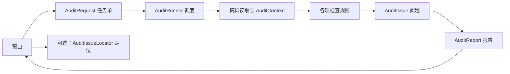

# 大白话架构说明
[返回首页](../README.md)

## 它就像一个体检站
前台接待你，组长安排检查，资料员拿资料，各科医生判断，最后出报告。插件本身不替你“治疗”，修复由你完成。

| 角色 | 代码 | 工作 |
| --- | --- | --- |
| 前台 | LocalizationAuditorWindow | 画按钮、报告和筛选界面 |
| 前台的记事本 | LocalizationAuditorWindowState | 记住目标、运行状态、报告 |
| 组长 | AuditRunner | 调用规则、组织检查和汇总 |
| 任务单 | AuditRequest | 说明本次目标和规则等配置 |
| 共用资料包 | AuditContext | 为规则提供检查上下文 |
| 资料员 | 目标发现与资源读取代码 | 获取翻译表和序列化引用 |
| 医生 | IAuditRule 的实现 | 每条规则检查一类问题 |
| 问题单 / 总报告 | AuditIssue / AuditReport | 记录问题及运行结果 |
| 带路的人 | AuditIssueLocator | 定位支持的场景或预制体对象 |

## 数据怎么流动

这是一张理解用的概念图，不表示所有类之间都存在直接方法调用。

## 四个检查员
- StringTableCompletenessRule：某语言是不是漏了词条。
- EmptyTranslationRule：词条建了，但内容是不是空的。
- LocalizedStringReferenceRule：组件指向的翻译表或词条是否有效。
- TmpFontCoverageRule：资料足够时判断字体字符覆盖，否则明确未验证。

例如：按钮引用 Menu 表的 StartGame，后来词条被删除。读取器找到引用，引用规则发现它失效，报告记录按钮所在资源和对象路径，窗口展示，用户修复后复查。

## 为什么不全写在一个文件里？
- 改窗口排版，不应影响规则的判断。
- 加一条规则，不必重写整套扫描流程。
- 读取 Unity 资源和判断业务问题分开，便于测试。
- 用统一报告格式，让界面不必认识每条规则的内部细节。

## 两条重要边界
1. 扫描以只读为设计目标，但需要文件哈希和场景状态验证；定位会改变选中对象或编辑环境，不等于扫描行为。
2. 这是 Editor 工具，不是游戏运行时翻译服务；它不能保证覆盖所有动态生成内容。
