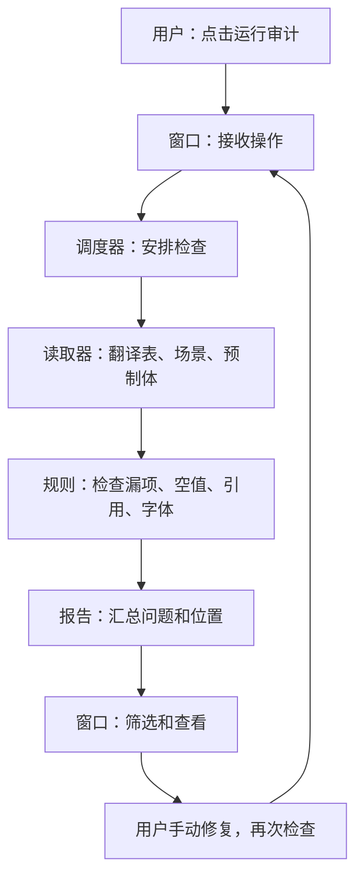

# Unity Localization Auditor
**Unity 项目的多语言“体检工具”：发现漏词条、空翻译和失效引用。**

这是一个运行在 Unity 编辑器里的检查插件，不是自动翻译工具，也不会自动修复游戏内容。当前包版本为 **0.1.0（验证阶段）**，尚未完成正式发布验收。

## 能做什么
| 检查 | 大白话解释 |
| --- | --- |
| 翻译表完整性 | 某种语言是否漏了词条 |
| 空翻译 | 词条存在，但翻译内容为空 |
| 本地化引用 | 场景、预制体的组件是否引用了不存在的表或词条 |
| TMP 字体覆盖 | 具备字体映射等必要信息时，检查字符能否显示 |

提供结果筛选，以及部分场景/预制体问题的对象定位。**NotVerified（未验证）不是通过。**

## 快速开始
1. 先备份或提交你的 Unity 项目。
2. 打开包管理器，选择通过 Git URL 添加包，粘贴：
   ```text
   https://github.com/tanxiangdong72-sys/unity-translation-plugin-checker.git?path=Packages/com.yxwm.localization-auditor#c0d0df4d925943a68153514ae14cbdb6fb7444e4
   ```
3. 等待导入、编译完成，确认控制台没有编译错误。
4. 打开 **Window（窗口）→ Localization Auditor**。
5. 点击 **Refresh / 刷新目标**，再点击 **Run Audit / 运行审计**。
6. 查看问题，手动修复后重新检查。

上面的固定提交是已验证安装流程的代码基线，不会自动跟随 main 更新。开发跟踪可将 URL 末尾改成 `#main`，更新后仍应检查实际解析的提交。

## 环境与边界
- 已有安装/窗口/扫描流程验证环境：**Unity 6000.5.10f1**。
- 包声明最低 Unity 6000.0，依赖 Localization 1.5.12；声明不代表所有 Unity 6 小版本都通过验证。
- 老版 Unity 的兼容性工作尚未形成当前 main 的完整支持承诺。
- 窗口从 Assets 下发现 Scene/Prefab；没有这类目标时不能从窗口启动扫描。
- 当前窗口尚未提供完整字体映射配置，字体检查可能返回未验证。
- 定位主要面向带对象路径的 Scene/Prefab 问题；翻译表问题不支持通过该按钮直接定位。
- 静态检查不能保证发现运行时动态生成的所有问题。
- 0 个问题不等于所有能力都验证通过。

## 架构：像一次体检

文字版：**窗口接任务 → 调度器安排 → 读取器找资料 → 规则查问题 → 报告展示 → 人工修复复查。**

## 文档导航
- [使用指南与常见问题](Docs/USER_GUIDE.md)
- [大白话架构说明](Docs/ARCHITECTURE.md)
- [怎样验证检查真的有效](Docs/VALIDATION_GUIDE.md)
- [当前状态和后续计划](Docs/STATUS.md)
- [参与开发](CONTRIBUTING.md)
- [变更记录](CHANGELOG.md)
- [原始产品决策文档](Docs/Product/unity-localization-auditor-decision.md)

## 仓库结构
```text
Packages/com.yxwm.localization-auditor/
  Editor/      编辑器窗口、数据模型、读取与扫描、检查规则
  Tests/       EditMode 测试与样本清单
Assets/        验证宿主项目资源
ProjectSettings/  验证宿主项目配置
Docs/          使用、架构、验证与历史记录
```
安装插件只需要上面的 UPM 子目录；开发与测试则使用仓库内的 Unity 宿主项目。

## 反馈与许可
通过 [Issues](https://github.com/tanxiangdong72-sys/unity-translation-plugin-checker/issues) 提交问题，请附 Unity 版本、包提交、第一条错误和复现步骤，勿上传私有项目或密钥。

当前仓库尚未指定许可证；公开可见不代表已授予任意复制、修改和分发许可。许可证由维护者后续决定。
